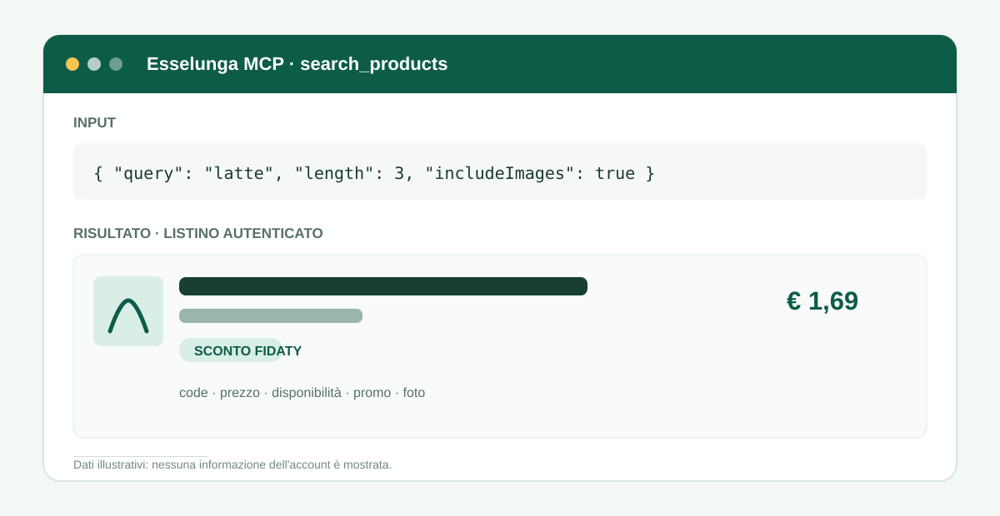
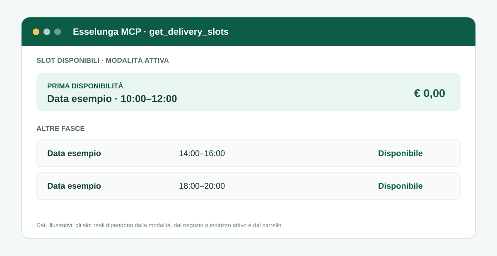

# Esselunga MCP

Server MCP locale per cercare prodotti Esselunga, filtrare offerte e leggere o aggiornare il carrello. È scritto in TypeScript e comunica via `stdio`.

Il catalogo è interrogato in sola lettura. Il carrello usa una sessione HTTP locale rinnovata automaticamente; il server non può completare checkout o pagamento.

## Uso personale e privacy

Questo progetto è non ufficiale ed è pensato esclusivamente per uso personale e privato, sul proprio account Esselunga. Non è affiliato, approvato né supportato da Esselunga e non intende arrecare danno, offesa o pregiudizio a Esselunga, ai suoi servizi o ai suoi utenti. Usa esclusivamente dati e credenziali del proprietario dell'account, non raccoglie né condivide informazioni di terzi e non deve essere usato per aggirare controlli, limitazioni o misure di sicurezza del sito.

Chi installa o utilizza il server si assume integralmente la responsabilità del suo impiego, della custodia delle proprie credenziali e del rispetto di termini di servizio, leggi e regolamenti applicabili. Gli autori e i contributori non assumono alcuna responsabilità per usi impropri, danni, perdite di dati o conseguenze derivanti dall'uso del progetto.

## Requisiti

- Windows
- Node.js 20 o successivo
- Google Chrome installato, solo per la configurazione iniziale della sessione
- Un account Esselunga già abilitato al servizio che intendi usare

## Installazione passo per passo

1. Installa [Node.js 20 o successivo](https://nodejs.org/) e verifica l'installazione:

```powershell
node --version
npm --version
```

2. Clona il repository e apri la relativa cartella:

```powershell
git clone https://github.com/sednik/EsselungaMcpUnofficial.git
cd EsselungaMcpUnofficial
```

3. Installa le dipendenze e crea la configurazione locale:

```powershell
npm install
Copy-Item .env.example .env
```

Il file `.env` è già escluso da Git. Non inserire né condividere password, cookie, token o il file della sessione. Per la normale installazione non devi compilare manualmente i valori di `.env`.

## Configurazione iniziale: una sola volta

Esegui:

```powershell
npm run setup
```

Lo script apre Chrome e aspetta fino a dieci minuti. Nella finestra:

1. Accedi a Esselunga.
2. Completa l’eventuale verifica a due fattori.
3. Attendi la chiusura automatica della finestra.

Al termine viene creato `.esselunga-session.json`. Contiene i cookie rinnovabili della sessione e viene ignorato da Git.

Non devi copiare cookie dal browser né cambiare valori in `.env` durante il normale utilizzo.

Se Esselunga revoca la sessione o chiede una nuova verifica, ripeti `npm run setup`.

## Collegamento al client MCP

Configura il tuo client MCP per avviare il server dalla cartella del repository. La forma esatta della schermata cambia da client a client; la configurazione equivalente è:

```json
{
  "command": "node",
  "args": ["node_modules/tsx/dist/cli.mjs", "src/index.ts"],
  "cwd": "<cartella-del-repository>"
}
```

Sostituisci soltanto `<cartella-del-repository>` con la cartella in cui hai clonato il progetto. Non inserire credenziali nel file di configurazione del client.

## Avvio e verifica locale

```powershell
npm start
```

Il processo aspetta le richieste MCP su standard input. Non scrivere messaggi aggiuntivi su standard output: è riservato al protocollo.

Per provare il server con MCP Inspector:

```powershell
npx @modelcontextprotocol/inspector node_modules/tsx/dist/cli.mjs src/index.ts
```

Nella pagina di Inspector premi **Connect**, poi apri **Tools**.

## Esempi visivi

Le immagini seguenti sono anteprime illustrative dell'output MCP, create senza dati dell'account o del carrello.

### Ricerca prodotti



### Slot di consegna o ritiro



## Strumenti MCP

### `server_status`

Mostra lo stato del server e delle integrazioni configurate.

### `search_products`

Cerca nel catalogo Esselunga. Esempio:

```json
{
  "query": "latte",
  "length": 10
}
```

Puoi filtrare un tipo di promozione:

```json
{
  "query": "latte",
  "promotion": "SCONTO FIDATY"
}
```

Il risultato include `code`, `productId`, prezzo, prezzo scontato, disponibilità, promozioni, eventuali intervalli di peso e `imageURL`. Quando la sessione è configurata, la ricerca usa il listino autenticato associato all'account/punto vendita; il campo `priceContext` lo indica. Per aggiungere un prodotto al carrello serve il valore `code`, non `productId`.

Imposta `includeImages: true` per allegare alla risposta fino a quattro foto direttamente nella chat LLM, se il client MCP supporta contenuti immagine:

```json
{
  "query": "latte",
  "length": 4,
  "includeImages": true
}
```

In alternativa usa `get_product_image` passando un `imageURL` ottenuto dalla ricerca. Il tool restituisce una singola immagine MCP ed evita di scaricare URL esterni al catalogo Esselunga.

### `get_product_details`

Legge il dettaglio del prodotto e restituisce gli eventuali `productIntervals` (peso/pezzatura) e `productAttributeIds`. È utile prima di aggiungere un prodotto a peso variabile.

### `get_cart`

Legge il carrello senza modificarlo. Restituisce `trolleyItemId`, `productCode`, quantità, descrizione, prezzi base e scontati, prezzo effettivo per quantità/peso, promozioni, disponibilità e totale autenticato. I valori provengono dal riepilogo checkout Esselunga associato alla stessa sessione del carrello.

`pricing.totalPromoDiscount` è calcolato dalle differenze tra prezzo pieno e prezzo scontato di ogni riga, quindi include le promo che il backend non inserisce nel proprio aggregato. Il valore originale, quando presente, rimane disponibile come `pricing.reportedPromoDiscount`.

I campi `quantityAwarePrice`, `discountedQuantityAwarePrice` ed `effectiveQuantityAwarePrice` sono totali di riga: per gli articoli a pezzo tengono conto della quantità; per gli articoli a peso usano il prezzo già calcolato da Esselunga per la pezzatura selezionata.

Quando una riga ha una sola promozione ma Esselunga ne omette il valore, il server valorizza `promotions[0].value` con lo sconto calcolato della riga, espresso come importo negativo.

### `get_delivery_slots`

Mostra date e fasce orarie di consegna o ritiro disponibili per il profilo e il carrello correnti, senza prenotare né cambiare lo slot. Per impostazione predefinita restituisce solo gli slot prenotabili, con prezzo ed eventuale termine ultimo di prenotazione:

```json
{
  "availableOnly": true,
  "limit": 20
}
```

La risposta include anche `firstAvailable` e, se presente, `currentReservation`. Per vedere anche slot non disponibili, usa `availableOnly: false`.

> **Contesto di consegna:** gli slot restituiti appartengono esclusivamente alla modalità attiva nel tuo account Esselunga al momento della richiesta (consegna a domicilio oppure ritiro/Drive) e al relativo negozio o indirizzo selezionato. Il tool non confronta le due modalità, non cambia indirizzo o punto vendita e non prenota/modifica uno slot.

### `update_cart`

Modifica il carrello e richiede sempre `confirm: true` per eseguire l’azione. Prima puoi fare un’anteprima con `confirm: false`.

Aggiunta di un prodotto:

```json
{
  "action": "add",
  "productCode": "302050",
  "quantity": 1,
  "confirm": false
}
```

Ripeti la stessa richiesta con `"confirm": true` per applicarla.

Modifica quantità di una riga esistente:

```json
{
  "action": "set_quantity",
  "trolleyItemId": 123456,
  "quantity": 2,
  "confirm": true
}
```

Rimozione di una riga:

```json
{
  "action": "remove",
  "trolleyItemId": 123456,
  "confirm": true
}
```

Per i prodotti a peso variabile, chiama prima `get_product_details`. Se è disponibile un solo intervallo, `update_cart` lo usa automaticamente; se ne esistono più di uno, scegli quello desiderato con `productIntervalId`:

```json
{
  "action": "add",
  "productCode": "CODICE_PRODOTTO",
  "productIntervalId": 123456,
  "quantity": 1,
  "confirm": true
}
```

Per le eventuali opzioni richieste dal prodotto, passa gli identificativi selezionati in `productAttributeIds`. La quantità resta il numero di unità dell’intervallo scelto; il peso effettivo è determinato dal prodotto/pezzatura indicati da Esselunga.

### `start_auth_wizard` e `complete_auth_wizard`

Sono l’alternativa MCP a `npm run setup`. Usali in questa sequenza:

1. Chiama `start_auth_wizard`.
2. Completa il login manualmente nella finestra Chrome.
3. Chiama `complete_auth_wizard`.

## Gestione della sessione

Il server conserva la sessione HTTP in `.esselunga-session.json` e tenta il rinnovo SSO in automatico all’avvio e dopo una risposta `401`.

Il login iniziale non viene automatizzato con username e password perché Esselunga usa SSO, reCAPTCHA e può richiedere 2FA. Il wizard è necessario solo quando la sessione non è più rinnovabile.

## Limiti attuali

- Nessun checkout, pagamento o invio ordine.
- Le offerte richiedono una query di ricerca; l’elenco completo senza query non è implementato.
- Gli endpoint Esselunga sono interni e possono cambiare senza preavviso.

Vedi [docs/esselunga-api-study.md](docs/esselunga-api-study.md) per gli appunti tecnici sugli endpoint osservati.
